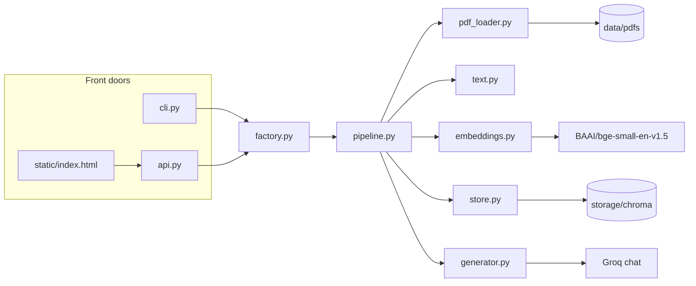
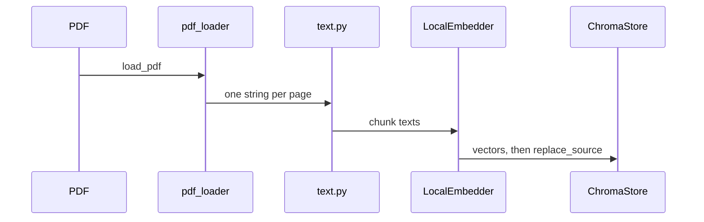
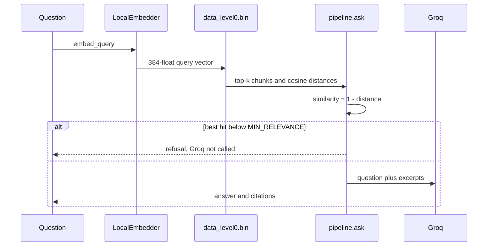

# PDF RAG

Ask a question. Get an answer grounded in your PDFs, with the file and page it came from.

Text is extracted per page, split into overlapping chunks, and embedded on disk with `BAAI/bge-small-en-v1.5`. Chroma stores the vectors and searches them with cosine similarity. Groq (`openai/gpt-oss-120b`) writes the answer from the retrieved excerpts only. If nothing clears `MIN_RELEVANCE`, Groq is not called.

```
PDF  ->  pages  ->  chunks  ->  local embeddings  ->  Chroma
question  ->  query embedding  ->  nearest chunks  ->  Groq  ->  answer + page
```


## Contents

- [Architecture](#architecture)
- [Ingest](#ingest)
- [Ask](#ask)
- [Repository](#repository)
- [Run](#run)
- [Test document](#test-document)
- [Configuration](#configuration)
- [Read the source](#read-the-source)
- [Tests](#tests)
- [Limits](#limits)

## Architecture

`RagPipeline` is the only place that orders the work. It depends on three protocols in `src/rag/ports.py`, not on Groq or Chroma. `factory.py` builds the real implementations. The CLI and the HTTP API both call that factory, so they cannot drift apart.



| Piece | File | Role |
| --- | --- | --- |
| Data | `models.py` | `PdfPage`, `Chunk`, `IndexedChunk`, `RetrievedChunk`, `Answer` |
| Contracts | `ports.py` | `Embedder`, `VectorStore`, `Generator` |
| Orchestration | `pipeline.py` | `ingest_pages`, `ask`, `select_passages` |
| Wiring | `factory.py` | `build_pipeline()` |
| Pages | `pdf_loader.py` | pypdf, one text block per page |
| Chunks | `text.py`, `ids.py` | split inside a page, stable ids |
| Vectors | `embeddings.py` | local BGE, or Groq nomic if the key allows it |
| Index | `store.py` | Chroma, cosine |
| Answer | `prompts.py`, `generator.py` | grounded prompt, Groq chat |
| Config | `config.py` | `.env` |
| Doors | `cli.py`, `api.py`, `static/` | terminal, HTTP, browser |

## Ingest

`pipeline.ingest_pages` does the work. Embeddings are computed before the previous copy of that file is deleted, so a failed call leaves the old index in place. Re-ingesting the same path replaces only that file.



1. `load_pdf` reads each page. Encrypted PDFs and scanned pages with no text layer are rejected.
2. `source_label` stores the path relative to the working directory, for example `data/pdfs/Company-Information-Helix.pdf`. That string is the citation source.
3. `chunk_text` splits on blank line, line, sentence, then word. A chunk never crosses a page and never exceeds `CHUNK_SIZE` (1000 characters, 150 overlap).
4. The chunk id is `{source}-p{page}-c{index}-{sha256[:16]}`.
5. `LocalEmbedder.passage_embed` returns 384 floats. The stored text does not include a task prefix.
6. `ChromaStore.replace_source` deletes that source's ids, then upserts ids, text, vectors, and metadata (`source`, `page`, `chunk_index`).

The collection metadata records `hnsw:space=cosine` and `embed_model=BAAI/bge-small-en-v1.5`. Opening the collection with a different model or distance is refused. Delete `storage/chroma` and ingest again. Old and new vectors are not comparable.

## Ask

The question string is not compared to the chunk text. It is embedded, and that vector is compared with the stored vectors.



1. `embed_query` builds a 384-float vector in memory. It is not written to sqlite.
2. Chroma searches the HNSW index at `storage/chroma/<segment-uuid>/data_level0.bin`. Distance is cosine because `hnsw:space` is `cosine`.
3. Similarity is `1 - distance`, clamped to `[0, 1]`.
4. `--source` is an equality filter on metadata `source`, not a similarity score.
5. `select_passages` drops hits under `MIN_RELEVANCE`. The cutoff lives in Python, not in sqlite.
6. Surviving chunk texts are sent to Groq in one user message. There is no system prompt, because the chat model is a reasoning model. The model may only use those excerpts. If they do not contain the answer it must reply exactly: `I cannot find that in the provided documents.`

`TOP_K` defaults to 5. `MIN_RELEVANCE` defaults to 0.3. On this small index, unrelated chunks still score about 0.5, so 0.3 lets extra sources through. Use `--min-relevance 0.6` on the Helix PDF when you want only the strong hit. The raw cosine is a neighbor score, not a calibrated probability.

After the search, these sqlite values are read, not compared:

| Table | What you get back |
| --- | --- |
| `embedding_metadata` key `chroma:document` | Chunk text sent to Groq |
| `embedding_metadata` keys `source`, `page`, `chunk_index` | Citation |
| `embeddings_queue.vector` | Same floats as the HNSW file, kept as a write log. Search does not read this blob. |
| `embeddings` | `embedding_id` and `seq_id` only. The pointer from a row to a slot in the HNSW index. |

`embedding_fulltext_search*` holds the same text for Chroma's keyword index. This ask path does not query it.

## Repository

```
src/rag/           package
  config.py        .env
  models.py        data types
  ports.py         the three protocols
  pipeline.py      ingest and ask
  factory.py       wires implementations
  pdf_loader.py    PDF to pages
  text.py          chunking
  ids.py           chunk ids
  embeddings.py    local BGE or Groq nomic
  store.py         Chroma
  prompts.py       grounded prompt
  generator.py     Groq chat
  cli.py           ingest, ask, stats
  api.py           HTTP API
  static/          browser UI
data/pdfs/         PDFs, including the Helix fixture
storage/chroma/    index, gitignored
tests/             no Groq calls
Dockerfile
docker-compose.yml
.env.example
```

Ignore `.venv/`, `storage/chroma/`, and `src/vectordb_rag.egg-info/` when reading the project. Those are the environment, the index, and install metadata.

## Run

`python` on a stock Windows install is the Microsoft Store stub and will fail. Use the venv interpreter below, or activate it first. In Git Bash: `source .venv/Scripts/activate`. If printing an answer throws `UnicodeEncodeError`, set `PYTHONIOENCODING=utf-8`.

### Local

```powershell
cd c:\Users\PC\Herd\python\vectordbRag
uv venv --python 3.12 .venv
.\.venv\Scripts\Activate.ps1
uv pip install -e ".[dev]"
copy .env.example .env
```

Editable install is required. The package lives in `src/`. `pip install -r requirements.txt` alone will not make `python -m rag` work.

Put a key from https://console.groq.com/keys in `.env`:

```
GROQ_API_KEY=gsk_...
```

Index and ask:

```powershell
.venv\Scripts\python.exe -m rag ingest data\pdfs
.venv\Scripts\python.exe -m rag stats
.venv\Scripts\python.exe -m rag ask "Who is the CEO?" --source data/pdfs/Company-Information-Helix.pdf
.venv\Scripts\python.exe -m rag ask "Who is the CEO?" --json
```

From Python:

```python
from pathlib import Path

from rag.factory import build_pipeline

rag = build_pipeline()
rag.ingest_pdf(Path("data/pdfs/Company-Information-Helix.pdf"))
answer = rag.ask("Who is the CEO?")
print(answer.text)
for citation in answer.citations:
    print(citation.source, citation.page, round(citation.score, 3))
```

### Docker

One container serves the UI and the API. The embedding model is baked into the image. Answers still go to Groq. `data/pdfs` and `storage` are bind-mounted, so an index you already built is the one the UI searches. `.env` is read at runtime and is not copied into the image.

```powershell
docker compose up --build -d
docker compose logs -f
docker compose run --rm rag python -m rag stats
docker compose down
```

Open http://localhost:8000.

The page lists indexed files, accepts a question, and can upload a PDF (32 MB max) or re-index `data/pdfs`. Ctrl+Enter submits. The Retrieval disclosure sets `k` and `min_relevance` for that question.

### HTTP

| Method | Path | Body |
| --- | --- | --- |
| `GET` | `/api/health` | |
| `GET` | `/api/stats` | |
| `POST` | `/api/ask` | `{"question": "...", "source": null, "k": null, "min_relevance": null}` |
| `POST` | `/api/ingest` | `{"path": "data/pdfs"}` |
| `POST` | `/api/upload` | multipart field `file`, a `.pdf` |

`/api/ask` returns:

```json
{
  "question": "Who is the CEO?",
  "answer": "Dr. Ingrid Solheim",
  "answered_from_context": true,
  "citations": [
    {"source": "data/pdfs/Company-Information-Helix.pdf", "page": 1, "score": 0.8, "text": "..."}
  ]
}
```

`answered_from_context: false` means the cutoff fired, the index was empty, or the model refused from the excerpts. `citations` on a refusal are the nearest excerpts, labeled that way in the CLI and the UI.

## Test document

`data/pdfs/Company-Information-Helix.pdf` is the fixture. Seven pages, fictional Helix Harbor knowledge base (HHT-KB-2026-001). Text extracts cleanly. It mixes prose, tables, API snippets, an FAQ, and exact ids (`HH-ORD…`, `HX` serials, `INC-####`) so you can check chunking, semantic search, and numeric lookup on one file.

Ingest it once, then these questions have a known answer:

| Question | Expected answer |
| --- | --- |
| Who is the CEO? | Dr. Ingrid Solheim |
| Max depth of AquaSense Pro? | 150 m |
| Restocking fee? | 12 percent |
| How long are encryption keys rotated? | every 90 days |
| Longest SEV2 incident in 2025? | INC-0491, 1 h 22 min |
| Alert rule limit per account? | 250 |
| What is the stock ticker? | `I cannot find that in the provided documents.` |

```bash
.venv/Scripts/python.exe -m rag ingest data/pdfs/Company-Information-Helix.pdf
.venv/Scripts/python.exe -m rag ask "Who is the CEO?" --source data/pdfs/Company-Information-Helix.pdf --min-relevance 0.6
```

`Answer.citations` is the ground truth, in retrieval order. The model sometimes prints `【1】` instead of `[1]`. Match the claim to the source list.

## Configuration

Every knob is an environment variable, documented in `.env.example` and loaded by `config.py`.

| Setting | Default | Why |
| --- | --- | --- |
| `GROQ_CHAT_MODEL` | `openai/gpt-oss-120b` | Public Groq chat model. Llama 3.3 was removed on 2026-08-16. |
| `GROQ_REASONING_EFFORT` | `low` | Extraction. Use `medium` or `high` for multi-hop questions. |
| `GROQ_TEMPERATURE` | `0.2` | Tight answers. Raise toward 0.5–0.7 if a reasoning model starts repeating. |
| `GROQ_MAX_COMPLETION_TOKENS` | `2048` | Empty completions mean this was too low. |
| `INCLUDE_REASONING` | `false` | Do not return the reasoning trace. |
| `EMBED_PROVIDER` | `local` | This key has no embedding model. `groq` calls `GROQ_EMBED_MODEL`. |
| `LOCAL_EMBED_MODEL` | `BAAI/bge-small-en-v1.5` | 384-d on-disk embedder. |
| `GROQ_EMBED_MODEL` | `nomic-embed-text-v1_5` | Used only when `EMBED_PROVIDER=groq`. |
| `CHUNK_SIZE` / `CHUNK_OVERLAP` | `1000` / `150` | Characters. Overlap must be smaller than size. |
| `TOP_K` | `5` | Passages retrieved. |
| `MIN_RELEVANCE` | `0.3` | Cosine cutoff. `0.6` is tighter on the Helix fixture. |
| `CHROMA_PATH` | `storage/chroma` | On-disk index. |
| `COLLECTION_NAME` | `pdf_rag` | Chroma collection. |

## Read the source

Read `src/rag/` in this order. Each file has one job. Start at `pipeline.py` if you only want the control flow, then jump to the callee you care about.

1. `models.py` — the types that cross module boundaries.
2. `ports.py` — what the pipeline is allowed to call.
3. `pipeline.py` — `ingest_pages` and `ask`.
4. `pdf_loader.py`, `text.py`, `ids.py` — pages, chunks, ids.
5. `embeddings.py`, `store.py` — vectors and the cosine query.
6. `prompts.py`, `generator.py` — the prompt and the refusal string.
7. `factory.py` — which classes are real in production.
8. `cli.py`, `api.py`, `static/` — the front doors.
9. `config.py` — validation of `.env`.

`tests/` follows the same split. A behavior that is not obvious in `pipeline.py` is specified next to a fake embedder, store, or generator in `tests/test_pipeline.py`.

## Tests

```powershell
.venv\Scripts\python.exe -m pytest
```

These do not call Groq or download a model, except that `test_store.py` opens a temporary Chroma.

| File | What it locks |
| --- | --- |
| `tests/test_chunking.py` | Size, overlap, no chunk past the limit |
| `tests/test_ids.py` | Same text, same id |
| `tests/test_prompts.py` | Refusal phrase and `[1]` numbering |
| `tests/test_pipeline.py` | Embed before replace, cutoff skips Groq, empty index |
| `tests/test_store.py` | Cosine order, replace one source, model mismatch refused |
| `tests/test_pdf_loader.py` | Extraction, missing file, encrypted file |
| `tests/test_config.py` | Bad env values |
| `tests/test_api.py` | Ask, upload, paths outside the PDF folder |

The Helix table above is the manual check. The unit tests do not read that PDF.

## Limits

- No OCR. A scanned PDF returns "no extractable text".
- No chat memory. Each question is independent. A follow-up has to repeat the subject.
- No keyword stage and no reranker. Retrieval is cosine over the chunk vectors, then a fixed cutoff. Exact ids and table rows are only found when a nearby chunk happens to rank high.
- Citations are the passages actually sent to the model. Marker glyphs in the answer text are not reliable.
- Encrypted PDFs are rejected.
